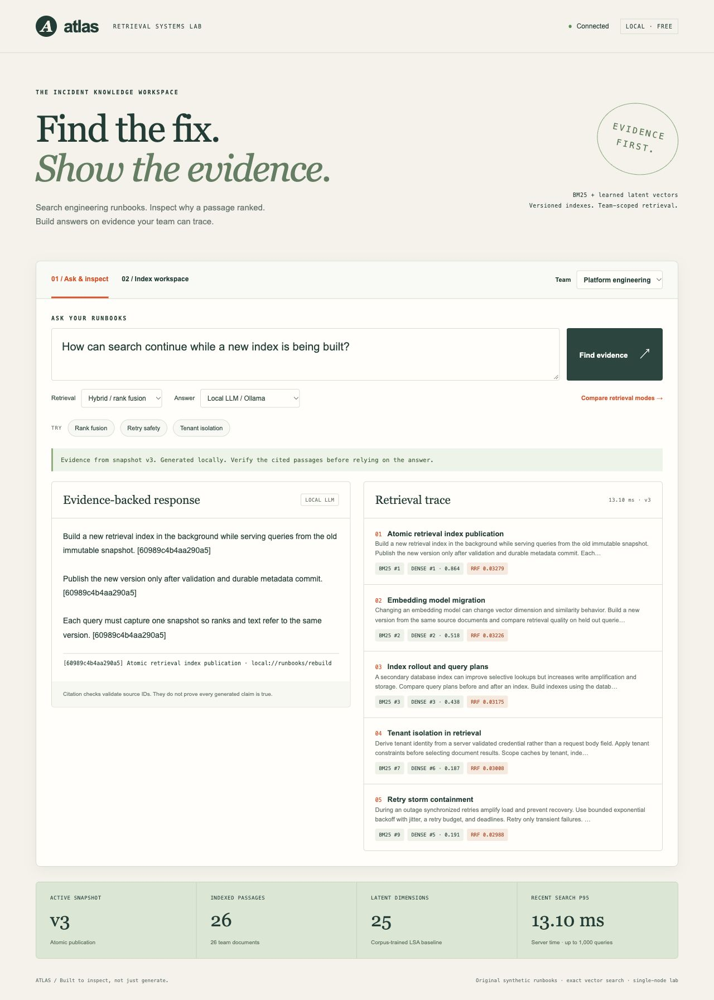
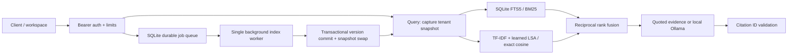

# Atlas — evidence before answers

A local, multi-tenant incident knowledge service with a working retrieval API, durable background indexing, versioned snapshots, and a workspace for inspecting search and citations. It combines SQLite FTS5/BM25 with corpus-trained TF-IDF/LSA vectors using reciprocal rank fusion. An optional **local** Qwen model through Ollama generates cited answers. Without Ollama it quotes retrieved passages and explicitly labels them as extractive.

**No hosted AI API, billing account, cloud deployment, subscription, or paid dependency is required.** All runbooks are original synthetic examples. Model downloads need internet once; subsequent inference runs locally.



## Run locally

Python 3.12+ on macOS or Linux (the single-writer process lock uses `fcntl`):

```sh
python3 -m venv .venv
. .venv/bin/activate
pip install -r requirements.txt
python -m atlas.server
```

Open **http://127.0.0.1:8092**. The demo has two team credentials: `atlas-demo-platform` and `atlas-demo-payments`. These are public demonstration values for synthetic data. For your own documents set `ATLAS_KEYS` to a JSON object mapping secret credentials (16+ chars) to tenant slugs. Keys are supplied in Bearer headers, never query strings. The UI's custom-key input stays in memory.

```sh
curl http://127.0.0.1:8092/v1/search \
  -H 'Authorization: Bearer atlas-demo-platform' \
  -H 'Content-Type: application/json' \
  -d '{"query":"How can search continue during an index rebuild?","mode":"hybrid","k":5}'
```

Or run `docker compose up --build -d --wait`. The container is non-root, binds the host port to loopback, and persists SQLite in a named volume. Stop the source server first to free port 8092. `docker compose down` retains data.

## Free local language model

Install [Ollama](https://ollama.com/download) from its official distribution. The model is approximately 986 MB plus runtime memory. CPU inference works; first load is slower. Start a local-only Ollama service:

```sh
OLLAMA_NO_CLOUD=1 OLLAMA_HOST=127.0.0.1:11435 LLAMA_ARG_DEVICE=none ollama serve
# In a second terminal:
OLLAMA_HOST=127.0.0.1:11435 ollama pull qwen2.5:1.5b
# In a third terminal, from this repository:
OLLAMA_URL=http://127.0.0.1:11435 OLLAMA_MODEL=qwen2.5:1.5b python -m atlas.server
```

Choose **Local LLM / Ollama** in the workspace. Atlas permits only loopback HTTP model endpoints and rejects cloud model names. It does not implement remote model credentials or paid providers. The generation client has a 60-second timeout, one in-flight generation slot, a three-failure circuit breaker, and strict returned-citation ID checks. Failed validation returns an explicit error instead of presenting invented references. Valid IDs alone cannot establish factual entailment or resistance to prompt injection.

For Docker on Linux, an Ollama process must share the Atlas container's network namespace for the loopback-only client. The default Compose demo runs extractive answers; it does not provision a model. On macOS, use the native source launch for local generation.

## What is implemented

- **Retrieval:** exact BM25 and latent-vector search, deterministic RRF, rank/score provenance, mode comparison.
- **Index lifecycle:** queued validated upserts/deletes, full per-team rebuild, immutable model snapshots, transactional publication, last-good serving during builds, restart recovery.
- **Service controls:** credential-derived tenant scope, tenant/version/query-aware LRU+TTL cache, request/body/queue/concurrency limits, local process lock, explicit overload errors.
- **Evidence:** quoted passages or local-model answers, stable document/chunk IDs, citation validation, insufficient-evidence abstention.
- **Measurements:** labeled retrieval evaluation, uncached versus warm-cache latency, concurrency/load benchmark, live HTTP integration checks, regression tests, container CI.

## Verify

```sh
python -m unittest discover -s tests -v
python scripts/evaluate.py --output evaluation.json
python scripts/benchmark.py --output benchmark.json
python scripts/http_smoke.py --output http-smoke.json
# Only with local Ollama configured and running:
python scripts/llm_smoke.py --output llm-smoke.json
```

[Observed results](docs/VERIFICATION.md) distinguish local tests, local-model smoke checks, and hosted CI. The 36-query regression set was authored alongside 24 synthetic platform runbooks. It is not an independent relevance benchmark. The benchmark duplicates runbooks to load a larger index; its latency is not evidence of general retrieval quality. Hybrid is available to study a tradeoff, not assumed to outperform BM25.

## Architecture



See [design decisions and limits](docs/ARCHITECTURE.md), [API](docs/API.md), and [demo/interview walkthrough](docs/WALKTHROUGH.md). This is a bounded single-node service, not distributed vector infrastructure. LSA is trained from the indexed corpus; it is not a pretrained transformer embedding model. Exact cosine scans and full rebuilds favor inspectability at small scale. No highly available cluster or GCP deployment has been performed. MIT license applies to this code and original synthetic corpus; Qwen and Ollama retain their own licenses.
